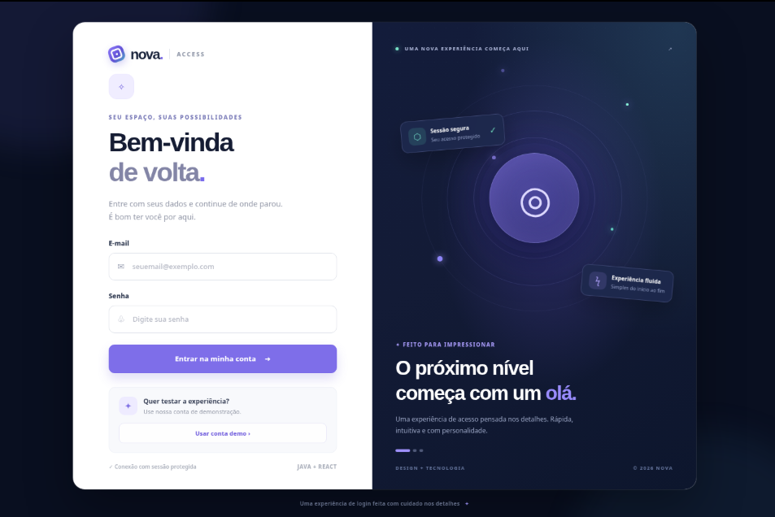
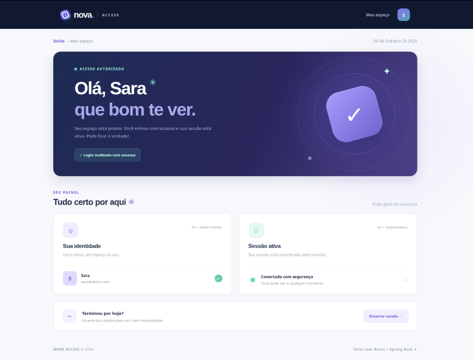

<div align="center">

# NOVA Access

### Uma experiência de autenticação completa, do primeiro acesso ao painel.

Aplicação full stack de autenticação com **Java 21, Spring Boot e React**.  
Uma demonstração prática de integração entre frontend e backend, sessões HTTP e uma interface pensada para oferecer uma experiência clara e consistente.

<p>
  
  
  
  
</p>

<p>
  <a href="#-demonstração">Demonstração</a> ·
  <a href="#-funcionalidades">Funcionalidades</a> ·
  <a href="#-como-executar">Como executar</a> ·
  <a href="#-arquitetura">Arquitetura</a>
</p>

</div>

---

## Visão geral

O **NOVA Access** é um projeto de portfólio que demonstra um fluxo de autenticação funcional entre uma aplicação React e uma API Java. A pessoa usuária entra com uma conta de demonstração, acessa um painel personalizado e pode encerrar a sessão.

Além da interface de login e do painel responsivo, o projeto utiliza autenticação por sessão HTTP gerenciada pelo Spring Security. O frontend obtém um token CSRF antes das operações protegidas, enquanto o cookie da sessão é configurado como `HttpOnly`.

## Demonstração

<p align="center">
  
  
</p>

*As imagens acima são capturas das telas incluídas neste projeto.*

## Funcionalidades

- Login com validação de credenciais e mensagens de erro.
- Preenchimento rápido da conta de demonstração.
- Autenticação com sessão HTTP mantida pelo Spring Security.
- Proteção CSRF nas operações de login e logout.
- Senha armazenada em memória usando hash BCrypt — nunca em texto puro.
- Painel privado com os dados da pessoa autenticada.
- Restauração da sessão ao recarregar a página.
- Logout que invalida a sessão no servidor.
- Interface responsiva em português, com opção de mostrar ou ocultar a senha.

## Tecnologias

| Área | Tecnologias |
| --- | --- |
| Backend | Java 21, Spring Boot 4.1.1, Spring Security, Maven |
| Frontend | React 19, Vite 6, JavaScript, CSS |
| Ícones | Lucide React |
| Autenticação | Sessão HTTP, cookie `HttpOnly`, CSRF e BCrypt |

## Como executar

Acesse o link: https://nova-access-nine.vercel.app/

### Conta de demonstração

| Campo | Valor |
| --- | --- |
| E-mail | `sara@demo.com` |
| Senha | `Demo@123` |

Na tela de login, também é possível usar **Usar conta demo** para preencher os campos automaticamente.

## Fluxo para testar

1. Abra `http://localhost:5173` e selecione **Usar conta demo**.
2. Envie o formulário para autenticar e abrir o painel.
3. Atualize a página: a sessão deverá continuar ativa.
4. Selecione **Encerrar sessão** para invalidar a sessão e voltar ao login.
5. Tente entrar com uma senha incorreta e confira a mensagem de erro.
6. Sem uma sessão autenticada, consulte `http://localhost:8080/api/auth/me`; a API deve responder com HTTP `401`.

## Arquitetura

```text
Navegador (React + Vite :5173)
        │
        ├── GET  /api/auth/csrf   → obtém token CSRF
        ├── POST /api/auth/login  → autentica e inicia a sessão
        ├── GET  /api/auth/me     → consulta o perfil autenticado
        └── POST /api/auth/logout → invalida a sessão
                    │
                    ▼
       Vite proxy → Spring Boot (:8080)
                    │
                    └── Spring Security + sessão HTTP + BCrypt
```

O cookie de sessão `JSESSIONID` é `HttpOnly`, e as respostas sensíveis usam `Cache-Control: no-store`. O cliente não persiste senha nem token de autenticação no `localStorage`; o token CSRF é obtido pela API e enviado no cabeçalho `X-CSRF-TOKEN` nas requisições POST.

## Endpoints da API

| Método | Endpoint | Descrição | Acesso |
| --- | --- | --- | --- |
| `GET` | `/api/auth/csrf` | Obtém o token CSRF | Público |
| `POST` | `/api/auth/login` | Autentica com `username` e `password` enviados como formulário | Público, com CSRF |
| `GET` | `/api/auth/me` | Retorna nome e e-mail do usuário autenticado | Autenticado |
| `POST` | `/api/auth/logout` | Invalida a sessão atual | Autenticado, com CSRF |

## Estrutura do projeto

```text
nova-access/
├── backend/
│   ├── pom.xml
│   └── src/main/
│       ├── java/com/portfolio/nova/
│       │   ├── NovaAccessApplication.java
│       │   ├── auth/AuthController.java
│       │   └── config/SecurityConfig.java
│       └── resources/application.properties
├── frontend/
│   ├── package.json
│   ├── vite.config.js
│   └── src/
│       ├── App.jsx
│       ├── api.js
│       ├── main.jsx
│       └── styles.css
├── img1.png
├── img2.png
└── README.md
```

## Decisões técnicas em destaque

- **Sessão em vez de token persistido no navegador:** a autenticação é mantida pelo servidor usando o mecanismo de sessão do Spring Security.
- **CSRF habilitado:** o frontend obtém o token pela API e o envia nas operações POST.
- **BCrypt:** a senha da conta de demonstração é codificada pelo `PasswordEncoder` do Spring Security.
- **Responsabilidades separadas:** React cuida da interface e das chamadas HTTP; Spring Boot controla autenticação, autorização e sessão.
- **Proxy de desenvolvimento:** o Vite encaminha `/api` ao backend local, simplificando a integração durante o desenvolvimento.

## Próximos passos

- Persistir usuários em um banco de dados com migrações.
- Criar fluxos de cadastro e recuperação de senha.
- Adicionar testes automatizados para frontend e backend.
- Implementar limitação de tentativas e observabilidade de autenticação.
- Preparar configuração de produção com HTTPS, cookies `Secure` e infraestrutura apropriada.

## Segurança e escopo

Este projeto é uma **demonstração para portfólio**, não um serviço pronto para produção. A conta é fixa e armazenada em memória; as credenciais de demonstração são públicas por definição. Não utilize a conta ou a configuração atual para proteger dados reais. Um deploy público requer, entre outras medidas, persistência e gerenciamento seguro de usuários, HTTPS e configurações de cookies adequadas ao ambiente.

## Apresentação para portfólio

> Desenvolvi uma aplicação full stack de autenticação com Java 21, Spring Boot, Spring Security e React. O projeto integra uma interface responsiva a uma API protegida, com sessão HTTP gerenciada no servidor, proteção CSRF, codificação de senha com BCrypt e fluxo completo de login, consulta de perfil e logout.
